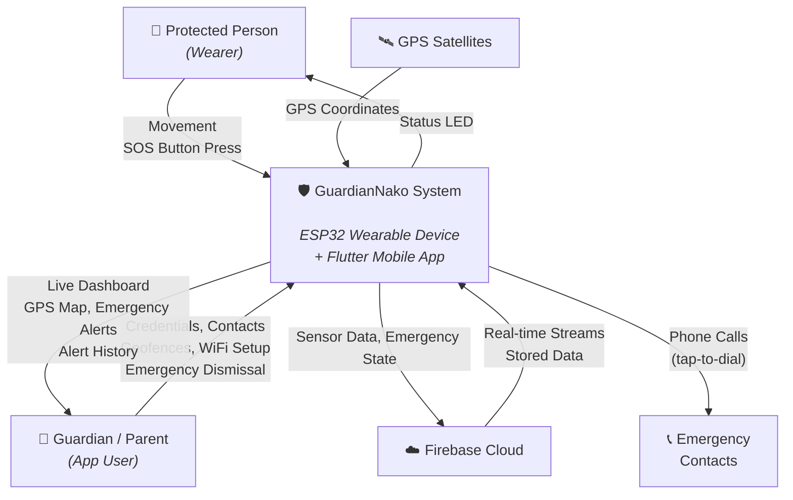

# Context Diagram — GuardianNako IoT Wearable Protection System

**Figure 1**

*Context Diagram of the GuardianNako System*

---

## What This Diagram Shows

The system sits between five external entities:

- **Protected Person (Wearer)** — the person being monitored. Wears the device. Their movement flows into the system; the system gives them visual feedback via an LED.
- **Guardian / Parent** — the caregiver using the mobile app. Sends configuration (contacts, geofences, WiFi credentials) to the system. Receives live monitoring data, GPS location, and emergency alerts.
- **GPS Satellites** — provide location coordinates to the wearable device.
- **Firebase Cloud** — the cloud backend. The system pushes sensor data and emergency state to Firebase; Firebase streams live data back to the mobile app.
- **Emergency Contacts** — people the guardian can call with one tap during an emergency.
