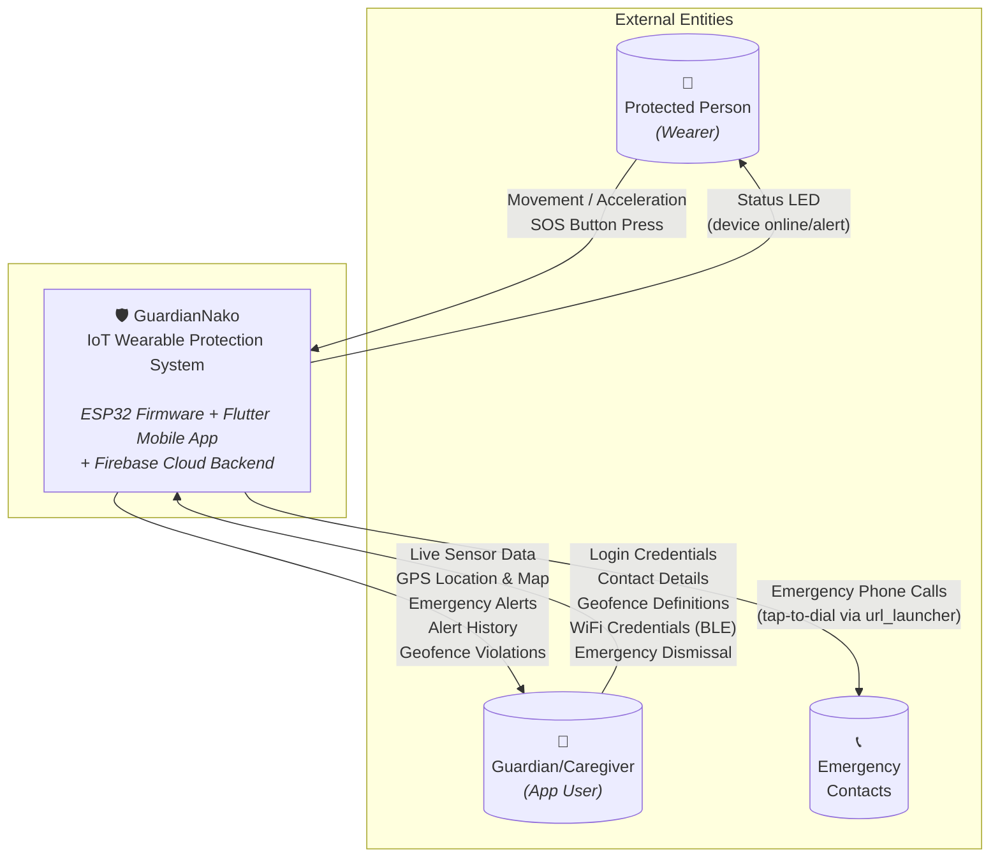

# Context Diagram — GuardianNako IoT Wearable Protection System

**Figure 1**

*Context Diagram of the GuardianNako IoT Wearable Protection System*

## Diagram Legend

| Symbol | Meaning |
|--------|---------|
| Rounded rectangle (center) | **The System** — the entire GuardianNako IoT solution being developed |
| Square nodes (left) | **External Entities** — people or roles that interact with the system but exist outside it |
| Directed arrows | **Data Flows** — the direction and label describe what information moves between the entity and the system |

---

## External Entities

| Entity | Description |
|--------|-------------|
| **Protected Person (Wearer)** | The individual wearing the ESP32 wearable device. Their physical movement is captured by the MPU6050 accelerometer, and they can manually trigger an SOS alert via the hardware button. |
| **Guardian/Caregiver (App User)** | The person responsible for monitoring the protected person. They interact with the Flutter mobile app to view live sensor data, GPS location, receive emergency alerts, manage contacts, configure geofences, and provision the device's WiFi credentials over BLE. |
| **Emergency Contacts** | Pre-configured contacts stored in Firestore under each user. During an active emergency, the Guardian can tap to call these contacts directly from the app via `url_launcher`. |

---

## Data Flow Summary

| # | From | To | Data | Mechanism |
|---|------|----|------|-----------|
| D1 | Protected Person | System | Movement/acceleration data, SOS button press | ESP32 sensors (MPU6050 + GPIO4) |
| D2 | System | Protected Person | Status LED indication (online/alert state) | ESP32 GPIO2 output |
| D3 | Guardian/Caregiver | System | Auth credentials, contact CRUD, geofence CRUD, WiFi credentials (BLE), emergency dismissal | Flutter app → Firebase Auth/Firestore/RTDB; BLE GATT |
| D4 | System | Guardian/Caregiver | Live sensor streams, GPS coordinates, emergency alerts, alert history, geofence violations | Firebase RTDB streams + Firestore queries → Flutter UI |
| D5 | System | Emergency Contacts | Emergency phone call (tap-to-dial) | `url_launcher` with `tel:` URI |

---

## System Boundary Notes

The GuardianNako system encompasses three tightly coupled subsystems that together form the solution:

1. **ESP32 Firmware** — Arduino C++ code on the wearable device that reads sensors, detects falls, checks geofences, and pushes data to Firebase every 2 seconds.
2. **Flutter Mobile App** — Cross-platform (Android/iOS) monitoring dashboard with real-time Firebase streams, BLE device provisioning, and emergency contact management.
3. **Firebase Cloud Backend** — Firebase Auth (email/password), Realtime Database (live sensor/emergency streams), and Cloud Firestore (persistent user data, contacts, geofences, alert history).

The internal communication between these subsystems (ESP32 → RTDB, RTDB → Flutter, Flutter → Firestore) occurs within the system boundary and is detailed in the Level 1 Data Flow Diagram.
