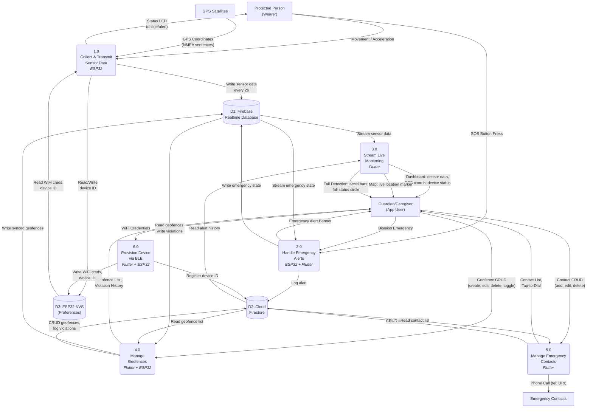
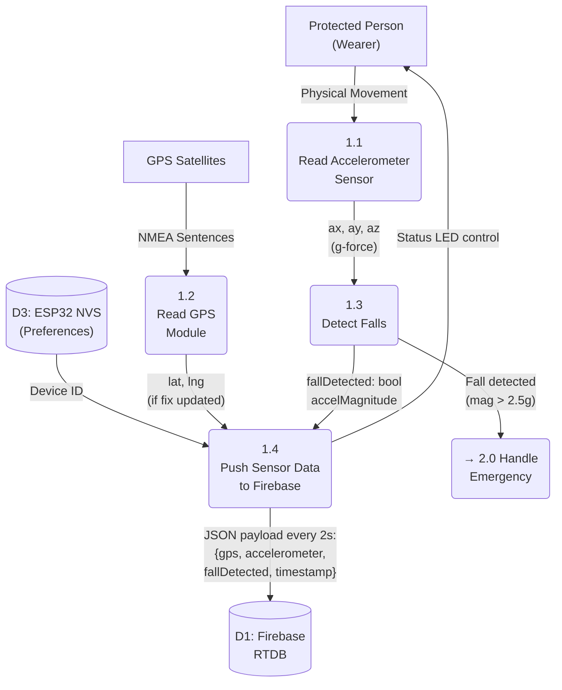
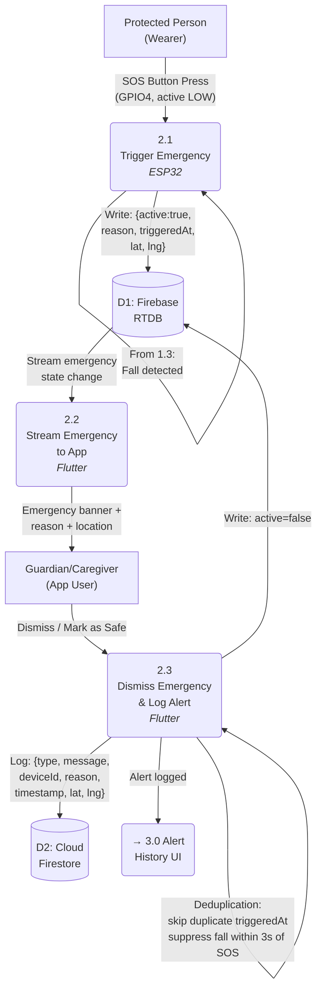
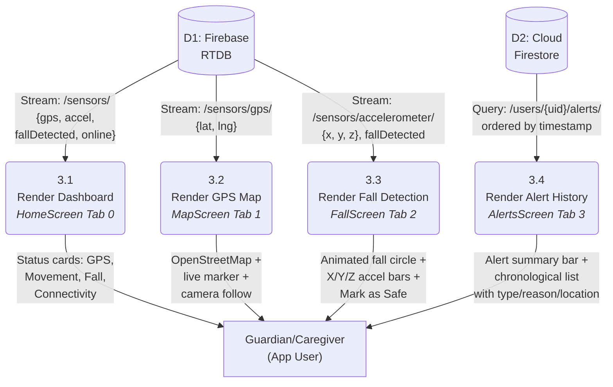
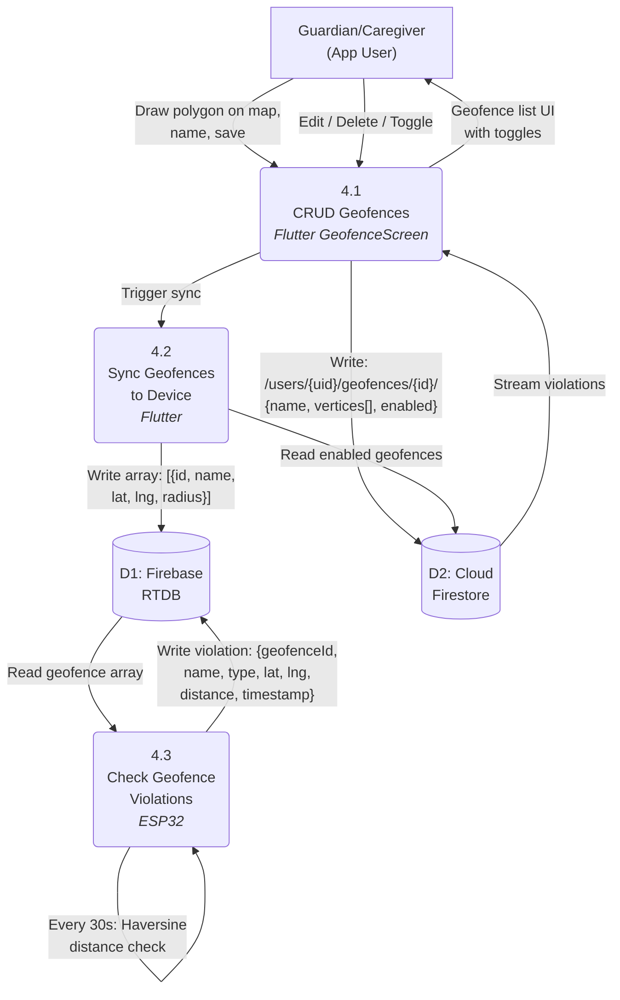
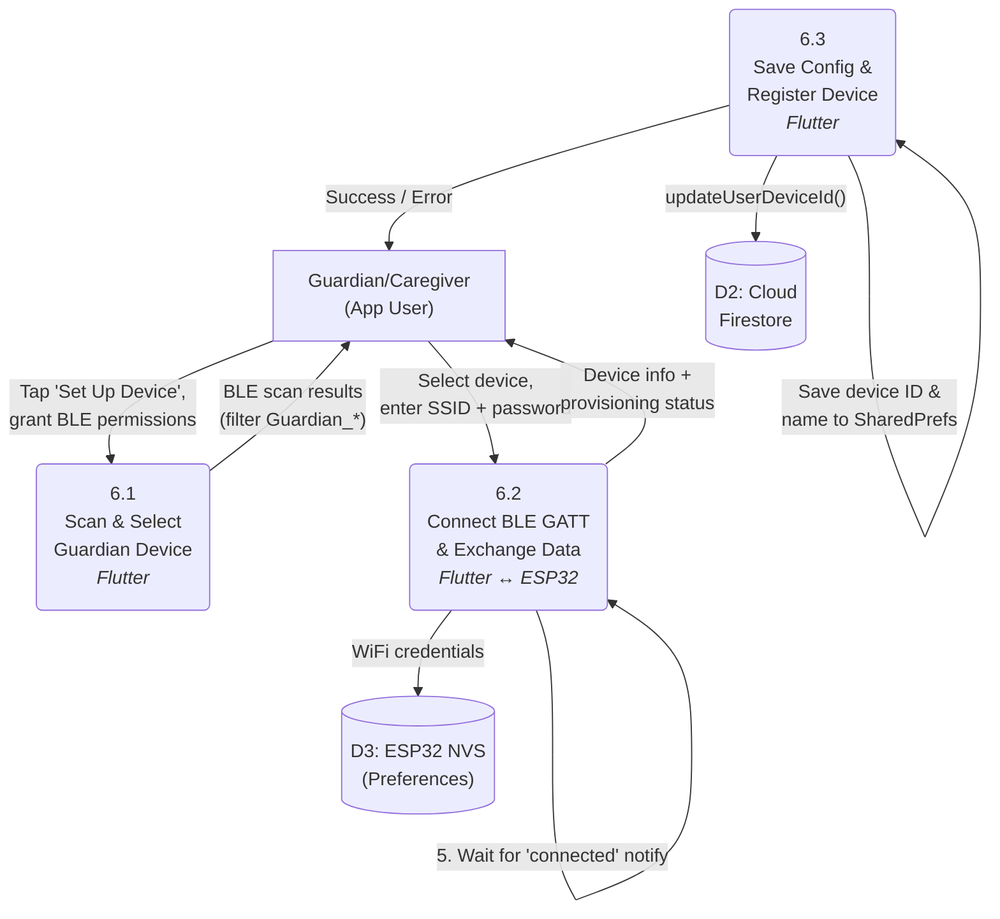

# Data Flow Diagram — GuardianNako IoT Wearable Protection System

## Level 1 DFD

**Figure 3**

*Level 1 Data Flow Diagram of the GuardianNako System*

---

## Level 2 DFDs

### Level 2 — Process 1.0: Collect & Transmit Sensor Data

**Figure 4**

*Level 2 DFD — Process 1.0: Collect & Transmit Sensor Data (ESP32)*

---

### Level 2 — Process 2.0: Handle Emergency Alerts

**Figure 5**

*Level 2 DFD — Process 2.0: Handle Emergency Alerts (ESP32 + Flutter)*

---

### Level 2 — Process 3.0: Stream Live Monitoring

**Figure 6**

*Level 2 DFD — Process 3.0: Stream Live Monitoring (Flutter)*

---

### Level 2 — Process 4.0: Manage Geofences

**Figure 7**

*Level 2 DFD — Process 4.0: Manage Geofences (Flutter + ESP32)*

---

### Level 2 — Process 6.0: Provision Device via BLE

**Figure 8**

*Level 2 DFD — Process 6.0: Provision Device via BLE (Flutter + ESP32)*

---

## Data Dictionary

### D1 — Firebase Realtime Database

| Path | Field | Type | Written By | Read By |
|------|-------|------|------------|---------|
| `/devices/{deviceId}/sensors/gps/lat` | Latitude | `double` | P1.4 (ESP32) | P3.1, P3.2 |
| `/devices/{deviceId}/sensors/gps/lng` | Longitude | `double` | P1.4 (ESP32) | P3.1, P3.2 |
| `/devices/{deviceId}/sensors/accelerometer/x` | Accel X | `float` | P1.4 (ESP32) | P3.1, P3.3 |
| `/devices/{deviceId}/sensors/accelerometer/y` | Accel Y | `float` | P1.4 (ESP32) | P3.1, P3.3 |
| `/devices/{deviceId}/sensors/accelerometer/z` | Accel Z | `float` | P1.4 (ESP32) | P3.1, P3.3 |
| `/devices/{deviceId}/sensors/fallDetected` | Fall flag | `bool` | P1.4 (ESP32) | P3.1, P3.3 |
| `/devices/{deviceId}/sensors/online` | Online flag | `bool` | P1.4 (ESP32) | P3.1 |
| `/devices/{deviceId}/sensors/timestamp` | Server time | `ServerTimestamp` | P1.4 (ESP32) | P3.1 |
| `/devices/{deviceId}/emergency/active` | Emergency active | `bool` | P2.1, P2.3 | P2.2 |
| `/devices/{deviceId}/emergency/reason` | Trigger reason | `string` | P2.1 | P2.2 |
| `/devices/{deviceId}/emergency/triggeredAt` | Trigger time | `ServerTimestamp` | P2.1 | P2.2 |
| `/devices/{deviceId}/emergency/lat` | Emergency lat | `double` | P2.1 | P2.2 |
| `/devices/{deviceId}/emergency/lng` | Emergency lng | `double` | P2.1 | P2.2 |
| `/devices/{deviceId}/geofences/` | Geofence array | `array` | P4.2 | P4.3 |
| `/devices/{deviceId}/geofence_violations/{ts}/` | Violation record | `object` | P4.3 | P4.1 |

### D2 — Cloud Firestore

| Path | Field | Type | Written By | Read By |
|------|-------|------|------------|---------|
| `/users/{uid}/name` | Display name | `string` | Auth flow | P3.1 |
| `/users/{uid}/email` | Email address | `string` | Auth flow | — |
| `/users/{uid}/deviceId` | Linked device | `string` | P6.3 | P3.1 |
| `/users/{uid}/contacts/{id}/name` | Contact name | `string` | P5 | P5 |
| `/users/{uid}/contacts/{id}/phone` | Contact phone | `string` | P5 | P5 |
| `/users/{uid}/contacts/{id}/relationship` | Relationship | `string` | P5 | P5 |
| `/users/{uid}/contacts/{id}/isEmergencyContact` | Emergency flag | `bool` | P5 | P5 |
| `/users/{uid}/geofences/{id}/name` | Geofence name | `string` | P4.1 | P4.1, P4.2 |
| `/users/{uid}/geofences/{id}/vertices` | Polygon vertices | `array<LatLng>` | P4.1 | P4.1, P4.2 |
| `/users/{uid}/geofences/{id}/enabled` | Enabled flag | `bool` | P4.1 | P4.2 |
| `/users/{uid}/alerts/{id}/type` | Alert type | `"sos"\|"fall"\|"emergency"` | P2.3 | P3.4 |
| `/users/{uid}/alerts/{id}/message` | Alert message | `string` | P2.3 | P3.4 |
| `/users/{uid}/alerts/{id}/deviceId` | Source device | `string` | P2.3 | P3.4 |
| `/users/{uid}/alerts/{id}/reason` | Trigger reason | `string` | P2.3 | P3.4 |
| `/users/{uid}/alerts/{id}/timestamp` | Event time | `Timestamp` | P2.3 | P3.4 |
| `/users/{uid}/alerts/{id}/latitude` | Event latitude | `double` | P2.3 | P3.4 |
| `/users/{uid}/alerts/{id}/longitude` | Event longitude | `double` | P2.3 | P3.4 |

### D3 — ESP32 NVS (Preferences)

| Key | Value | Written By | Read By |
|-----|-------|------------|---------|
| `wifi_ssid` | WiFi network name | P6.2 (BLE provisioning) | P1 (ESP32 boot) |
| `wifi_pass` | WiFi password | P6.2 (BLE provisioning) | P1 (ESP32 boot) |
| `device_id` | Auto-generated device ID | P1 (first boot) | P1.4, P6.2 |

---

## Process Summary

| ID | Process | Platform | Frequency | Input | Output |
|----|---------|----------|-----------|-------|--------|
| 1.1 | Read Accelerometer | ESP32 | Every loop | I2C Bus | ax, ay, az |
| 1.2 | Read GPS | ESP32 | Continuous | UART Serial | lat, lng |
| 1.3 | Detect Falls | ESP32 | Every loop | ax, ay, az | fallDetected bool |
| 1.4 | Push Sensor Data | ESP32 | Every 2s | Sensor readings | RTDB JSON |
| 2.1 | Trigger Emergency | ESP32 | On event | SOS button or fall | RTDB emergency |
| 2.2 | Stream Emergency | Flutter | Real-time | RTDB emergency path | UI alert banner |
| 2.3 | Dismiss & Log | Flutter | On user action | Dismiss tap | RTDB clear + Firestore log |
| 3.1 | Render Dashboard | Flutter | Real-time | RTDB /sensors/ | Status cards |
| 3.2 | Render GPS Map | Flutter | Real-time | RTDB /sensors/gps/ | Map marker |
| 3.3 | Render Fall Detection | Flutter | Real-time | RTDB /sensors/accelerometer/ | Accel bars + circle |
| 3.4 | Render Alert History | Flutter | Real-time | Firestore /alerts/ | Alert list |
| 4.1 | CRUD Geofences | Flutter | On user action | Polygon vertices | Firestore + UI |
| 4.2 | Sync Geofences | Flutter | On save/toggle | Firestore geofences | RTDB array |
| 4.3 | Check Violations | ESP32 | Every 30s | RTDB geofences | RTDB violations |
| 5.0 | Manage Contacts | Flutter | On user action | Contact form data | Firestore + UI |
| 6.1 | Scan & Select Device | Flutter | On setup | BLE advertisements | Device list |
| 6.2 | Connect & Exchange | Flutter ↔ ESP32 | Per provisioning | BLE GATT | WiFi creds + status |
| 6.3 | Save & Register | Flutter | Post-provisioning | Device info | SharedPrefs + Firestore |
