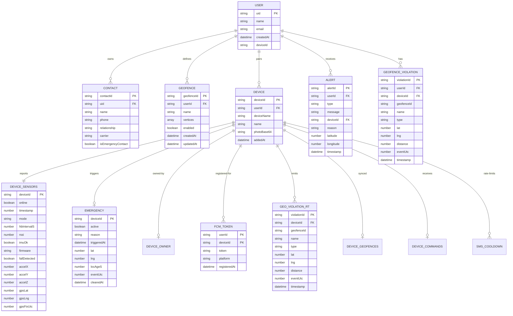
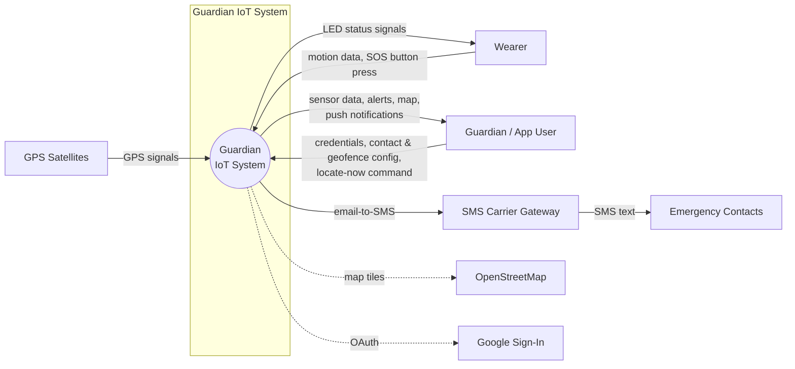
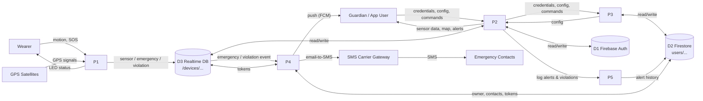
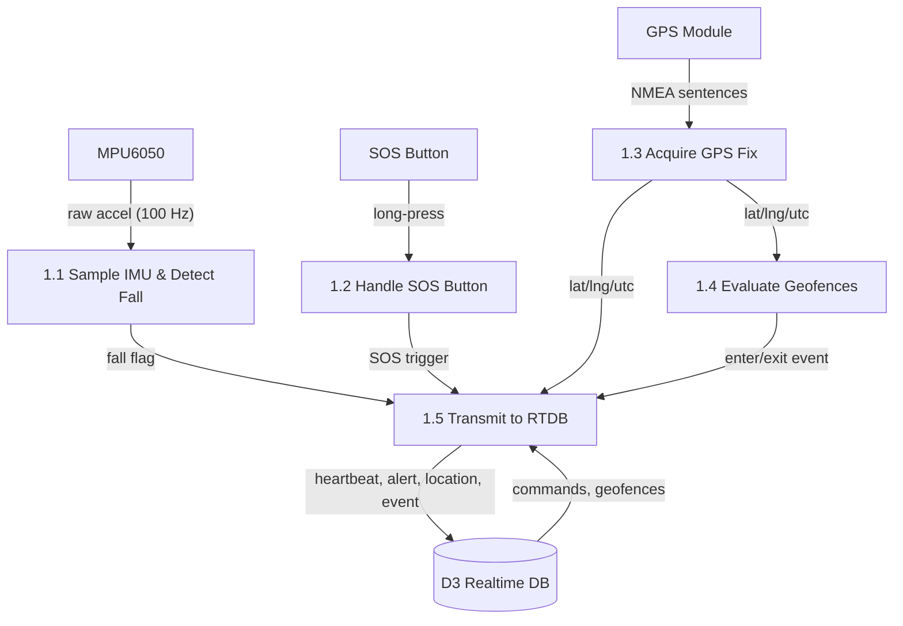
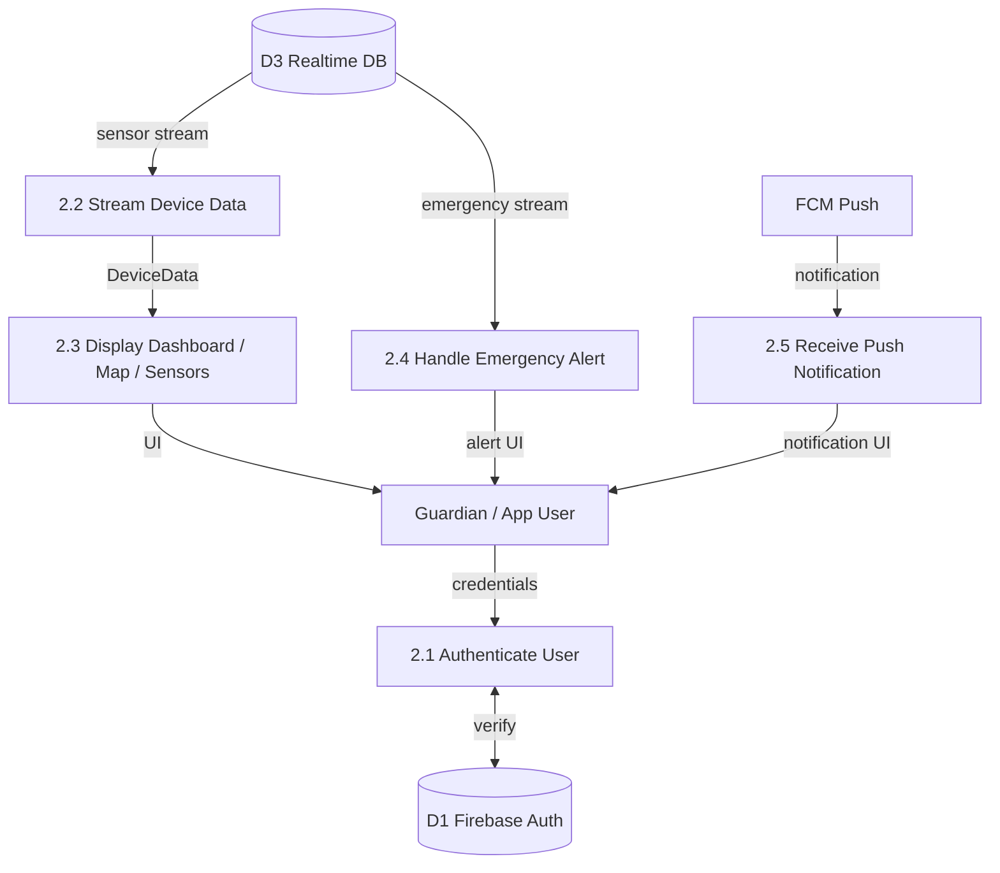
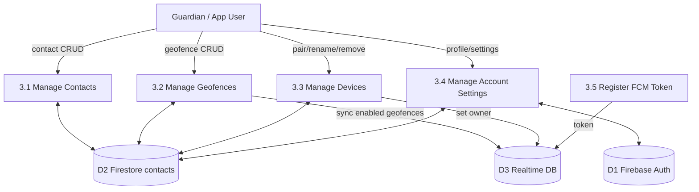
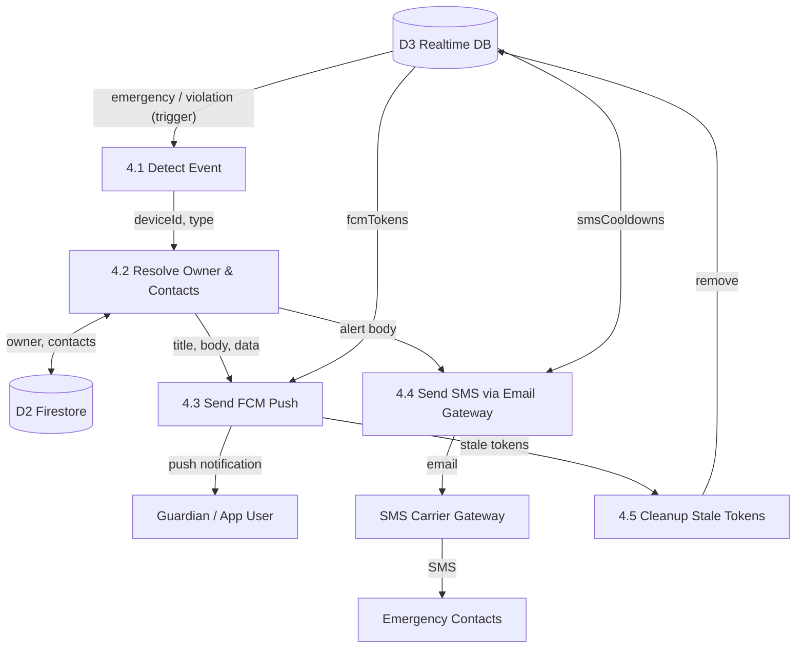
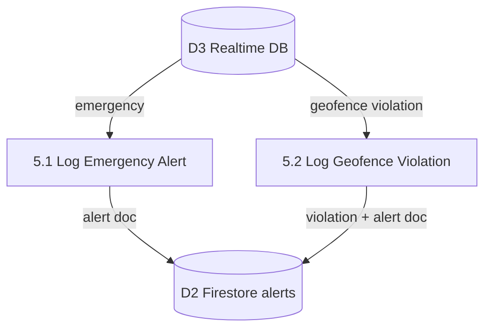

# Guardian IoT — Database Structure & Data Flow Documentation

> Companion reference for the Entity Relationship Diagram (ERD), Context
> Diagram, and Data Flow Diagrams (DFD Level 0 and Level 1) of the Guardian
> IoT Wearable Protection Device system.
>
> Backend: **Firebase** — Firebase Authentication, Cloud Firestore (persistent
> data), and Firebase Realtime Database / RTDB (real-time sensor streams).
> Notifications are handled by Firebase Cloud Functions (`functions/index.js`)
> or the equivalent Netlify Function (`netlify/functions/notify.js`).

---

## 1. Database Structure

The system uses two NoSQL databases plus Firebase Auth. They are described
here as **logical entities** so they can be drawn as an ERD.

| Layer | Technology | Purpose | Write access |
|-------|-----------|---------|--------------|
| Identity | Firebase Authentication | User accounts, email/password + Google | App |
| Persistent | Cloud Firestore | Users, contacts, geofences, devices, alert history | App |
| Real-time | Firebase Realtime Database (RTDB) | Device sensor stream, emergency state, FCM tokens, commands | ESP32 + App + Functions |

> **NoSQL note:** Firestore documents are grouped into *collections* and
> *sub-collections* (denoted `parent/{id}/child/{id}`). RTDB uses *paths*
> (denoted `/root/{key}/child`). There are no foreign-key constraints — the
> `deviceId` is the shared key that links the Firestore `devices` document to
> the RTDB `/devices/{deviceId}` tree.

---

### 1.1 Firestore — Persistent Data

#### 1.1.1 `users` (collection)

Root document per authenticated user. Document ID = Firebase Auth `uid`.

| Field | Data type | Key / notes |
|-------|-----------|-------------|
| `uid` | String | **PK** (document ID, from Auth) |
| `name` | String | Display name |
| `email` | String | Email address |
| `createdAt` | Timestamp | Server timestamp |
| `deviceId` | String | Active/selected device ID (optional) |

#### 1.1.2 `users/{uid}/contacts` (sub-collection)

Emergency / guardian contacts. Document ID = auto-generated.

| Field | Data type | Key / notes |
|-------|-----------|-------------|
| `contactId` | String | **PK** (auto ID) |
| `uid` | String | **FK** → `users` |
| `name` | String | Contact name |
| `phone` | String | Phone number |
| `relationship` | String | e.g. Parent, Spouse |
| `carrier` | String | Carrier for SMS gateway (e.g. `Globe (PH)`) |
| `isEmergencyContact` | Boolean | `true` → receives alerts |

#### 1.1.3 `users/{uid}/geofences` (sub-collection)

Safe-zone polygons. Document ID = auto-generated.

| Field | Data type | Key / notes |
|-------|-----------|-------------|
| `geofenceId` | String | **PK** (auto ID) |
| `userId` | String | **FK** → `users` |
| `name` | String | Zone name |
| `vertices` | Array\<Object\> | Polygon boundary: `[{lat, lng}, …]` |
| `enabled` | Boolean | Whether the fence is active |
| `createdAt` | Timestamp | Created time |
| `updatedAt` | Timestamp | Last modified time |

#### 1.1.4 `users/{uid}/devices` (sub-collection)

Paired wearable devices (also holds the wearer's profile). Document ID = the
`deviceId` (shared key with RTDB `/devices/{deviceId}`).

| Field | Data type | Key / notes |
|-------|-----------|-------------|
| `deviceId` | String | **PK** (document ID; shared with RTDB) |
| `userId` | String | **FK** → `users` (path key) |
| `deviceName` | String | User-assigned device name |
| `name` | String | Wearer's name |
| `photoBase64` | String | Wearer photo (base64) |
| `addedAt` | Timestamp | When paired |

#### 1.1.5 `users/{uid}/alerts` (sub-collection)

Alert history (emergency + geofence). Document ID = auto-generated.

| Field | Data type | Key / notes |
|-------|-----------|-------------|
| `alertId` | String | **PK** (auto ID) |
| `userId` | String | **FK** → `users` (path key) |
| `type` | String | `sos` \| `fall` \| `emergency` \| `geofence_exited` \| `geofence_entered` |
| `message` | String | Human-readable description |
| `deviceId` | String | **FK** → `devices` |
| `reason` | String | Raw trigger reason (emergency/fall only) |
| `latitude` | Number | Location at alert |
| `longitude` | Number | Location at alert |
| `timestamp` | Timestamp | When the event occurred |

#### 1.1.6 `users/{uid}/geofence_violations` (sub-collection)

Historical geofence enter/exit log. Document ID = auto-generated.

| Field | Data type | Key / notes |
|-------|-----------|-------------|
| `violationId` | String | **PK** (auto ID) |
| `userId` | String | **FK** → `users` (path key) |
| `deviceId` | String | **FK** → `devices` |
| `geofenceId` | String | Zone ID |
| `name` | String | Zone name |
| `type` | String | `entered` \| `exited` |
| `lat` | Number | Latitude at crossing |
| `lng` | Number | Longitude at crossing |
| `distance` | Number | Distance from zone center (m) |
| `eventUtc` | Number | Unix epoch seconds of crossing |
| `timestamp` | Timestamp | Server timestamp |

---

### 1.2 Realtime Database (RTDB) — Real-time Data

Root is `/devices/{deviceId}`. `deviceId` is the auto-generated
`guardian_<mac>` identifier.

#### 1.2.1 `/devices/{deviceId}/sensors`

Latest sensor snapshot (heartbeat + location). Written by ESP32.

| Field | Data type | Key / notes |
|-------|-----------|-------------|
| `deviceId` | String | **PK** (path key) |
| `online` | Boolean | True when heartbeating |
| `timestamp` | Number | Epoch ms (server timestamp) |
| `mode` | String | `resting` \| `active` \| `emergency` |
| `hbIntervalS` | Number | Heartbeat interval in seconds |
| `rssi` | Number | Wi-Fi signal strength |
| `imuOk` | Boolean | IMU health flag |
| `firmware` | String | Firmware version |
| `fallDetected` | Boolean | Fall detection flag |
| `accelerometer.x` | Number | Accel X (g) |
| `accelerometer.y` | Number | Accel Y (g) |
| `accelerometer.z` | Number | Accel Z (g) |
| `gps.lat` | Number | Latitude |
| `gps.lng` | Number | Longitude |
| `gps.fixUtc` | Number | GPS fix epoch seconds |

#### 1.2.2 `/devices/{deviceId}/emergency`

Active emergency state. Written by ESP32; cleared by app.

| Field | Data type | Key / notes |
|-------|-----------|-------------|
| `deviceId` | String | **PK** (path key) |
| `active` | Boolean | Emergency in progress |
| `reason` | String | `SOS button pressed` \| `Fall detected by accelerometer` |
| `triggeredAt` | Timestamp | When triggered |
| `lat` | Number | Latitude |
| `lng` | Number | Longitude |
| `locAgeS` | Number | Age of location (seconds) |
| `eventUtc` | Number | GPS epoch seconds |
| `clearedAt` | Timestamp | When app cleared it |

#### 1.2.3 `/devices/{deviceId}/owner`

Single value = the owning user's `uid`.

| Field | Data type | Key / notes |
|-------|-----------|-------------|
| `owner` | String | Value = **FK** → `users.uid` |

#### 1.2.4 `/devices/{deviceId}/fcmTokens/{userId}`

Push-notification registration per user/phone.

| Field | Data type | Key / notes |
|-------|-----------|-------------|
| `userId` | String | **PK** (path key) |
| `deviceId` | String | **FK** → device (path key) |
| `token` | String | FCM registration token |
| `platform` | String | `android` (or `ios`) |
| `registeredAt` | Timestamp | Registration time |

#### 1.2.5 `/devices/{deviceId}/geofence_violations/{violationId}`

Real-time geofence enter/exit (written by ESP32; the Cloud/Netlify Function
listens here and the app bridges it to Firestore).

| Field | Data type | Key / notes |
|-------|-----------|-------------|
| `violationId` | String | **PK** (push ID) |
| `deviceId` | String | **FK** → device (path key) |
| `geofenceId` | String | Zone ID |
| `name` | String | Zone name |
| `type` | String | `entered` \| `exited` |
| `lat` | Number | Latitude at crossing |
| `lng` | Number | Longitude at crossing |
| `distance` | Number | Distance from center (m) |
| `eventUtc` | Number | GPS epoch seconds |
| `timestamp` | Timestamp | Server timestamp |

#### 1.2.6 `/devices/{deviceId}/geofences`

List of enabled geofences synced from Firestore to the device (array).

| Field | Data type | Key / notes |
|-------|-----------|-------------|
| `[].id` | String | Geofence ID |
| `[].name` | String | Zone name |
| `[].vertices` | Array\<Object\> | `[{lat, lng}, …]` |

#### 1.2.7 `/devices/{deviceId}/commands`

Commands from the app, polled by the device.

| Field | Data type | Key / notes |
|-------|-----------|-------------|
| `locateNow` | Boolean | Request immediate GPS fix |
| `refreshGeofences` | Boolean | Re-download geofences |

#### 1.2.8 `/devices/{deviceId}/smsCooldowns/{contactId}`

Rate-limit timestamps for SMS (value = epoch ms of last send).

| Field | Data type | Key / notes |
|-------|-----------|-------------|
| `contactId` | String | **PK** (path key) |
| `value` | Number | Epoch ms of last SMS |

---

### 1.3 Firebase Authentication

Managed by Firebase (not a collection). Referenced as the source of `uid`,
`email`, and `name`.

| Field | Data type | Key / notes |
|-------|-----------|-------------|
| `uid` | String | **PK** |
| `email` | String | Unique |
| `displayName` | String | Mirrored to `users.name` |
| `passwordHash` | String | Managed internally |

---

### 1.4 Entity Relationship Diagram (Mermaid)

> **Relationship note:** `DEVICE` is the conceptual join point between the two
> databases. Its `deviceId` is both the Firestore document ID
> (`users/{uid}/devices/{deviceId}`) and the RTDB root key
> (`/devices/{deviceId}`). `DEVICE_OWNER`, `DEVICE_GEOFENCES`, and
> `DEVICE_COMMANDS` are single-node values/arrays (no attribute table needed).

---

## 2. Context Diagram

**External entities and their data flows**

| Entity | Input to system | Output from system |
|--------|-----------------|-------------------|
| Wearer | Motion (accelerometer), SOS button press | LED status |
| GPS Satellites | GPS signals (NMEA) | — |
| Guardian (App User) | Login credentials, contacts, geofences, device commands | Sensor/status data, alerts, map, push notifications |
| Emergency Contacts | — | SMS alerts |
| SMS Carrier Gateway | (relays email) | SMS text delivery |
| OpenStreetMap | (map tiles) | — |
| Google Sign-In | (OAuth identity) | — |

---

## 3. Data Flow Diagram — Level 0

**Processes**

| ID | Process | Description |
|----|---------|-------------|
| P1 | Detect & Transmit | ESP32: IMU fall detection, SOS button, GPS, geofence evaluation, RTDB upload |
| P2 | Monitor & Display | Flutter app: auth, real-time sensor/emergency streams, map & dashboard UI |
| P3 | Manage Configuration | Flutter app: contacts, geofences, devices, account settings |
| P4 | Notify | Cloud/Netlify Function: FCM push + email-to-SMS |
| P5 | Log & Archive | Flutter app: alert history + geofence violations to Firestore |

**Data stores**

| ID | Store | Contents |
|----|-------|----------|
| D1 | Firebase Auth | User accounts |
| D2 | Firestore | users, contacts, geofences, devices, alerts, violations |
| D3 | RTDB | /devices/{deviceId}/… sensors, emergency, tokens, commands |

---

## 4. Data Flow Diagram — Level 1

### 4.1 P1 — Detect & Transmit (ESP32 firmware)

### 4.2 P2 — Monitor & Display (Flutter app)

### 4.3 P3 — Manage Configuration (Flutter app)

### 4.4 P4 — Notify (Cloud/Netlify Function)

### 4.5 P5 — Log & Archive (Flutter app)

---

## 5. Data Dictionary — Common Data Types

| Type | Description |
|------|-------------|
| `String` | UTF-8 text |
| `Number` | Integer or floating-point (Firebase numeric) |
| `Boolean` | `true` / `false` |
| `Timestamp` | Server timestamp (Firestore `Timestamp` / RTDB `ServerValue.timestamp`) |
| `Array<Object>` | JSON array of objects (e.g. `vertices`) |
| `auto ID` | Firestore-generated document ID |
| `push ID` | RTDB-generated key |

---

## 6. Key Data-Flow Narratives

1. **Fall / SOS alert** — Wearer motion → ESP32 IMU/button → RTDB
   `/devices/{id}/emergency` → Cloud Function (trigger) → FCM push to Guardian
   + SMS to emergency contacts → app also logs it to Firestore `alerts`.
2. **Geofence breach** — GPS fix → on-device point-in-polygon → RTDB
   `/devices/{id}/geofence_violations` → Cloud Function → FCM push + SMS (exit
   only) → app bridges the event into Firestore `geofence_violations` and
   `alerts`.
3. **Heartbeat / live location** — ESP32 writes `/devices/{id}/sensors` on a
   schedule (120 s active / 300 s resting) → app RTDB stream updates the
   dashboard, map, and online/offline status.
4. **Command** — App writes `/devices/{id}/commands` (`locateNow`) → ESP32
   polls it every ~30–60 s → takes a fresh GPS fix and reports back.
