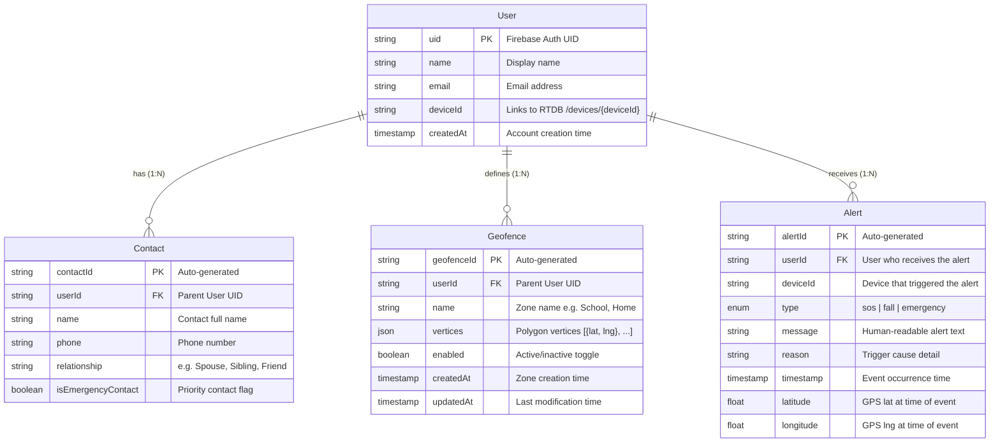

# Entity Relationship Diagram — GuardianNako IoT Wearable Protection System

**Figure 9**

*Entity Relationship Diagram of the GuardianNako System*

This system uses **two databases** for different purposes:
- **Cloud Firestore** — persistent, structured data (users, contacts, geofences, alert history)
- **Firebase RTDB** — transient, high-frequency data (sensor streams, emergency state, device cache)

---

## Firestore Entities (Persistent)

These entities live in Cloud Firestore and follow a document-collection model. All are nested under `/users/{uid}/`.



---

## RTDB Structures (Transient)

The Realtime Database stores live, high-frequency data as a flat JSON tree. These are NOT relational entities — they are hierarchical paths under a device node.

```
/devices/{deviceId}/
├── sensors/                              ← Written by ESP32 every 2s
│   ├── gps/
│   │   ├── lat: double
│   │   └── lng: double
│   ├── accelerometer/
│   │   ├── x: float
│   │   ├── y: float
│   │   └── z: float
│   ├── fallDetected: boolean
│   ├── online: boolean
│   └── timestamp: ServerTimestamp
├── emergency/                            ← Written by ESP32 on event
│   ├── active: boolean                   ← Cleared by Mobile App on dismiss
│   ├── reason: string
│   ├── triggeredAt: ServerTimestamp
│   ├── lat: double
│   └── lng: double
├── geofences/                            ← Synced from Firestore by Mobile App
│   └── [{ id, name, lat, lng, radius }, ...]
└── geofence_violations/                  ← Written by ESP32 every 30s
    └── {timestamp}/
        ├── geofenceId: string
        ├── name: string
        ├── type: "entered" | "exited"
        ├── lat: double
        ├── lng: double
        ├── distance: double
        └── timestamp: ServerTimestamp
```

---

## How the Two Databases Connect

There is only **one link** between Firestore and RTDB:

```
User.deviceId (Firestore)  ──────>  /devices/{deviceId} (RTDB)
```

When the guardian provisions a device via BLE, the ESP32's auto-generated device ID is saved to the User document in Firestore. From that point on, the app knows which RTDB path to listen to for live sensor data, emergency state, and geofence violations.

---

## Entity Descriptions

### User (Firestore)
Represents a registered guardian account. Created on first sign-up via Firebase Auth. Stored at `/users/{uid}/`. The `deviceId` field links to the RTDB device node.

### Contact (Firestore)
Emergency and regular contacts managed by the guardian. Stored as a subcollection at `/users/{uid}/contacts/{contactId}/`. Contacts flagged with `isEmergencyContact = true` appear in a prioritized section and can be dialed via tap-to-call.

### Geofence (Firestore)
A virtual geographic boundary defined by a polygon of GPS vertices. Stored at `/users/{uid}/geofences/{geofenceId}/`. When enabled, the Mobile App syncs a simplified point+radius version to RTDB for the ESP32 to enforce.

### Alert (Firestore)
A historical record of an emergency event (SOS press, fall detection, or geofence violation). Logged when an emergency is dismissed. Stored at `/users/{uid}/alerts/{alertId}/`. Each alert records the event type, reason, timestamp, and GPS location.

### Device (RTDB — not a Firestore entity)
The ESP32 wearable is represented in RTDB under `/devices/{deviceId}/`. It has no Firestore document. Its sub-paths hold live sensor readings, active emergency state, a cached geofence array for on-device enforcement, and geofence violation logs. Online status is derived: if the last sensor timestamp is older than 10 seconds, the device is considered offline.

### Geofence Violations (RTDB — not a Firestore entity)
Violation records are written directly by the ESP32 to RTDB at `/devices/{deviceId}/geofence_violations/{timestamp}/`. They are transient and not synced to Firestore. The guardian views them in real time via the RTDB stream.

---

## RTDB vs Firestore Mapping

| RTDB Path | Purpose | Persistent Copy in Firestore |
|-----------|---------|------------------------------|
| `/devices/{deviceId}/sensors/` | Live sensor stream (2s interval) | None (transient) |
| `/devices/{deviceId}/emergency/` | Active emergency state | `/users/{uid}/alerts/{alertId}/` (on dismiss) |
| `/devices/{deviceId}/geofences/` | Cached geofence array for ESP32 | `/users/{uid}/geofences/{geofenceId}/` (source of truth) |
| `/devices/{deviceId}/geofence_violations/` | Violation log from ESP32 | None (transient, RTDB-only) |

---

## Data Integrity Notes

- **Firestore subcollections**: Contacts, Geofences, and Alerts are subcollections under `/users/{uid}/`. The parent User UID is the implicit foreign key.
- **Cascading deletes**: Firestore does not auto-delete subcollections when a parent document is deleted. The app handles cleanup manually.
- **RTDB as cache**: The geofence array at `/devices/{deviceId}/geofences/` is a denormalized cache. Firestore is the source of truth; RTDB is what the ESP32 reads.
- **Geofence sync transformation**: Polygon vertices in Firestore are simplified to point+radius when synced to RTDB. The ESP32 uses Haversine distance checks, not full point-in-polygon calculations.
- **Offline detection**: Device online status is derived from timestamp staleness (last update > 10s = offline), not a stored field.
- **Alert deduplication**: ESP32 prevents re-triggering an already-active emergency. The app deduplicates by `triggeredAt` timestamp and suppresses fall alerts within 3 seconds of an SOS press.
