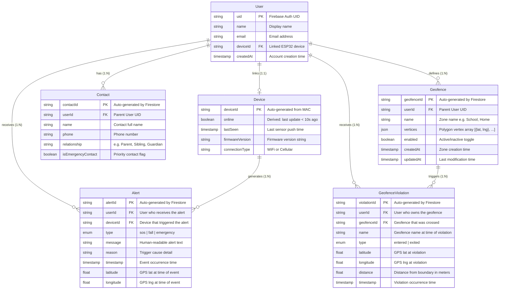

# Entity Relationship Diagram — GuardianNako IoT Wearable Protection System

**Figure 9**

*Entity Relationship Diagram of the GuardianNako System (Firestore)*



---

## Entity Descriptions

### User
Represents a registered Guardian/Caregiver account. Created on first registration via Firebase Auth. Stored in Firestore at `/users/{uid}/`. The `deviceId` field is populated after BLE device provisioning (UC07).

### Device
Represents the ESP32 wearable hardware. Not stored as a standalone Firestore document — inferred from RTDB sensor data at `/devices/{deviceId}/`. Device ID is auto-generated from the ESP32's MAC address on first boot. Online status is derived: if the last sensor timestamp is older than 10 seconds, the device is considered offline.

### Contact
Emergency and regular contacts managed by the Guardian. Stored as a subcollection under each user at `/users/{uid}/contacts/{contactId}/`. Contacts marked with `isEmergencyContact = true` appear in a prioritized section and can be dialed via tap-to-call during emergencies.

### Geofence
A virtual geographic boundary defined by a polygon of GPS vertices. Stored at `/users/{uid}/geofences/{geofenceId}/`. When enabled, the geofence is synced to the ESP32 device via RTDB, and the device checks for enter/exit violations every 30 seconds using the Haversine formula.

### Alert
A historical record of an emergency event (SOS press, fall detection, or manual emergency). Logged by the Flutter app when an emergency is detected via RTDB stream. Stored at `/users/{uid}/alerts/{alertId}/`. Each alert includes the event type, reason, timestamp, and GPS location at the time of the event.

### GeofenceViolation
A record of when the protected person entered or exited a geofence zone. Written by the ESP32 to RTDB, then synced to Firestore at `/users/{uid}/geofence_violations/{violationId}/`. Includes the violation type (entered/exited), distance from the boundary, and GPS coordinates at the time of violation.

---

## RTDB Structure (Non-Relational)

The Realtime Database stores transient, high-frequency data in a flat JSON tree. These paths are NOT modeled as relational entities but are shown here for completeness.

```
/devices/{deviceId}/
├── sensors/                              ← Written by ESP32 every 2s
│   ├── gps/
│   │   ├── lat: double
│   │   └── lng: double
│   ├── accelerometer/
│   │   ├── x: float
│   │   ├── y: float
│   │   └── z: float
│   ├── fallDetected: boolean
│   ├── online: boolean
│   └── timestamp: ServerTimestamp
├── emergency/                            ← Written by ESP32 on event
│   ├── active: boolean                   ← Cleared by Flutter on dismiss
│   ├── reason: string
│   ├── triggeredAt: ServerTimestamp
│   ├── lat: double
│   └── lng: double
├── geofences/                            ← Written by Flutter, read by ESP32
│   └── [{ id, name, lat, lng, radius }, ...]
└── geofence_violations/                  ← Written by ESP32 every 30s check
    └── {timestamp}/
        ├── geofenceId: string
        ├── name: string
        ├── type: "entered" | "exited"
        ├── lat: double
        ├── lng: double
        ├── distance: double
        └── timestamp: ServerTimestamp
```

### RTDB vs Firestore Mapping

| RTDB Path | Purpose | Persistent Copy |
|-----------|---------|-----------------|
| `/devices/{deviceId}/sensors/` | Live sensor stream (2s interval) | None (transient) |
| `/devices/{deviceId}/emergency/` | Active emergency state | `/users/{uid}/alerts/{alertId}/` (after dismiss) |
| `/devices/{deviceId}/geofences/` | Synced geofence cache for ESP32 | `/users/{uid}/geofences/{geofenceId}/` (source of truth) |
| `/devices/{deviceId}/geofence_violations/` | Violation log from ESP32 | `/users/{uid}/geofence_violations/{violationId}/` (synced copy) |

---

## Relationship Summary

| Relationship | Cardinality | Parent | Child | FK Field |
|-------------|-------------|--------|-------|-----------|
| User — Device | 1:1 | User | Device | `User.deviceId` → `Device.deviceId` |
| User — Contact | 1:N | User | Contact | `Contact.userId` (parent doc) |
| User — Geofence | 1:N | User | Geofence | `Geofence.userId` (parent doc) |
| User — Alert | 1:N | User | Alert | `Alert.userId` (parent doc) |
| User — Violation | 1:N | User | Violation | `Violation.userId` (parent doc) |
| Device — Alert | 1:N | Device | Alert | `Alert.deviceId` |
| Geofence — Violation | 1:N | Geofence | Violation | `Violation.geofenceId` |

---

## Data Integrity Notes

- **Firestore subcollections**: Contacts, Geofences, Alerts, and Violations are Firestore subcollections nested under `/users/{uid}/`. The parent User UID is the implicit foreign key — the `userId` field on each child document is also stored explicitly for query convenience.
- **Cascading deletes**: Firestore does not auto-delete subcollections when a parent document is deleted. The app must handle cleanup manually.
- **RTDB as cache**: The geofence array at `/devices/{deviceId}/geofences/` is a denormalized cache of enabled Firestore geofences. Firestore is the source of truth; RTDB is read by the ESP32.
- **Offline detection**: Device online status is not a stored field but derived from timestamp staleness (last update > 10s = offline). No separate heartbeat mechanism is used.
- **Alert deduplication**: Multiple layers prevent duplicate alerts: ESP32 guards against re-triggering an already-active emergency; Flutter deduplicates by `triggeredAt` timestamp and suppresses fall alerts within 3 seconds of an SOS press.
