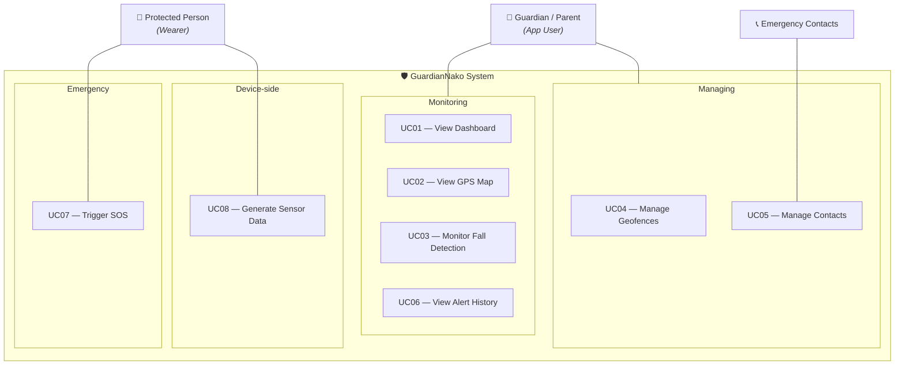

# Use Case Diagram — GuardianNako IoT Wearable Protection System

**Figure 2**

*Use Case Diagram of the GuardianNako System*

---

## Use Cases

### Monitoring

| ID | Use Case | Actor | What Happens |
|----|----------|-------|-------------|
| UC01 | View Dashboard | Guardian | See live sensor data, GPS coordinates, device status, and emergency banners in real time |
| UC02 | View GPS Map | Guardian | See the wearer's live location on an OpenStreetMap with auto-follow |
| UC03 | Monitor Fall Detection | Guardian | See real-time accelerometer bars and fall detection status circle |
| UC06 | View Alert History | Guardian | Browse a chronological list of past SOS, fall, and emergency alerts |

### Managing

| ID | Use Case | Actor | What Happens |
|----|----------|-------|-------------|
| UC04 | Manage Geofences | Guardian | Create, edit, delete, and toggle safe zones drawn on a map; the device enforces them automatically |
| UC05 | Manage Contacts | Guardian, Contacts | Add, edit, and delete emergency contacts with names, phone numbers, and relationships; tap to call |

### Emergency

| ID | Use Case | Actor | What Happens |
|----|----------|-------|-------------|
| UC07 | Trigger SOS | Wearer | Press the physical SOS button on the device to send an immediate alert with current location |

### Device-side

| ID | Use Case | Actor | What Happens |
|----|----------|-------|-------------|
| UC08 | Generate Sensor Data | Wearer | Normal body movement is captured by the device's accelerometer and GPS, producing the data that powers the entire monitoring system |

---

## Supporting Use Cases

These run behind the scenes and are included by the main use cases above.

| ID | Use Case | Included by |
|----|----------|-------------|
| UC09 | Stream Sensor Data | UC01, UC02, UC03, UC07, UC08 |
| UC10 | Store Persistent Data | UC04, UC05, UC06 |

---

## How Use Cases Connect

- The **Wearer** has two interactions with the system: generating sensor data (passive, through normal movement) and triggering SOS (active, by pressing the button).
- The sensor data generated by the Wearer powers the entire monitoring flow — without it, the Guardian's dashboard, map, and fall detection screens have nothing to display.
- If a **fall is detected** (from sensor data) or the **SOS button is pressed**, an emergency alert fires and appears on the Guardian's Dashboard and Fall Detection screens. The Guardian can clear the alert directly from either screen.
- The **Emergency Contacts** actor represents the people the Guardian manages in the system — they receive phone calls during emergencies but do not directly interact with the app.
- **Geofences** the Guardian creates are synced to the device; the device checks them automatically and logs violations.
